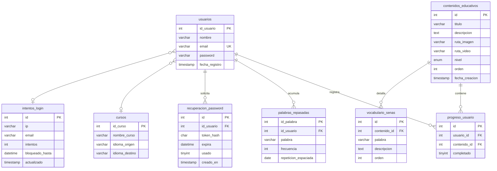

# 🤟 SEVA — Sistema Educativo de Lengua de Señas

**Plataforma Web Educativa, Inclusiva y Gamificada para el Aprendizaje de Lengua de Señas Colombiana (LSC)**

> **Estado:** En desarrollo · **PHP:** 8.2+ · **BBDD:** MariaDB `sevaeducativo` · **Accesibilidad:** WCAG 2.1 AA · **Seguridad:** OWASP Top 10 mitigada


---

## 📌 Tabla de Contenidos

- [Acerca del Proyecto](#acerca-del-proyecto)
- [Principios Pedagógicos e Inclusión](#principios-pedagógicos-e-inclusión)
- [Arquitectura de Software](#arquitectura-de-software)
- [Seguridad y Endurecimiento](#seguridad-y-endurecimiento)
- [Diseño UX/UI y Leyes Cognitivas](#diseño-uxui-y-leyes-cognitivas)
- [Accesibilidad W3C / WCAG 2.1 AA](#accesibilidad-w3c--wcag-21-aa)
- [Módulos Interactivos y Gamificación](#módulos-interactivos-y-gamificación)
- [Modelo de Datos (`sevaeducativo`)](#modelo-de-datos-sevaeducativo)
- [Guía de Instalación y Despliegue](#guía-de-instalación-y-despliegue)
- [Créditos y Licencia](#créditos-y-licencia)

---

## 🎯 Acerca del Proyecto

SEVA (Sistema Educativo de Lengua de Señas) es una plataforma tecnológica web concebida para derribar las barreras de comunicación que afectan a las personas con discapacidad auditiva, facilitando el aprendizaje interactivo de la Lengua de Señas Colombiana (LSC).

El sistema integra lecciones interactivas, seguimiento de gestos en tiempo real mediante visión artificial (MediaPipe Hand Tracking), algoritmos de repetición espaciada y una interfaz gamificada construida bajo los estándares internacionales de accesibilidad web.

---

## 📚 Principios Pedagógicos e Inclusión

El diseño instruccional de SEVA se fundamenta en tres pilares pedagógicos:

| Pilar | Descripción |
|---|---|
| **Diseño Universal para el Aprendizaje (DUA)** | Presentación del contenido mediante canales multisensoriales: video demostrativo en LSC, ilustraciones de dactilología, descripciones textuales y apoyo visual. |
| **Sistema Hipermedia Adaptativo (SHA)** | Evaluación del avance del usuario para personalizar la ruta de lecciones y las sugerencias de repaso. |
| **Repetición Espaciada** | Retención del vocabulario mediante el monitoreo de la frecuencia de práctica almacenada en la base de datos (`palabras_repasadas`). |

---

## 🏗️ Arquitectura de Software

El sistema aplica el principio de **Defensa en Profundidad**, aislando los archivos de configuración y base de datos fuera de la raíz pública accesible por el navegador (*DocumentRoot*).

```
seva/
├── config/                  ← PROTEGIDO: conexion.php, seguridad.php (fuera de la web pública)
├── DataBase/                ← PROTEGIDO: schema.sql, seed_demo.sql, migrations/
├── docs/                    ← PROTEGIDO: AUDITORIA/, MEMORIA_PROYECTO.md, PLAN_REMEDIACION.md
├── public/                  ← DOCUMENT ROOT: única carpeta servida vía HTTP
│   ├── index.html           ← Landing page institucional accesible
│   ├── login.php            ← Autenticación endurecida
│   ├── registro.php         ← Alta de usuario con validación en servidor
│   ├── dashboard.php        ← Ruta de aprendizaje "Tu Camino"
│   ├── leccion.php          ← Visor interactivo de lección con modo guiado
│   ├── practica.php         ← Centro de minijuegos interactivos
│   ├── perfil.php           ← Estadísticas del estudiante
│   ├── configuracion.php    ← Ajustes de accesibilidad y contraseña
│   ├── recuperar.php        ← Flujo de recuperación de contraseña
│   ├── restablecer.php      ← Verificación del token de recuperación
│   ├── logout.php           ← Cierre de sesión seguro
│   ├── css/                 ← Design Tokens (estilos.css, juegos.css, camara_ia.css, seva-animado.css)
│   ├── js/                  ← Lógica del cliente (seva-ui.js)
│   ├── img/                 ← Ilustraciones SVG, portadas y señas LSC
│   ├── media/               ← Demostraciones en video MP4
│   ├── data/                ← Datasets en formato JSON (lsc, alfabeto, colores, dias, familia)
│   ├── partials/            ← Barra de navegación compartida (topbar.php)
│   └── camara/              ← Módulo con IA para el detector de señas (detector.php)
```

---

## 🔒 Seguridad y Endurecimiento

SEVA incorpora múltiples capas de protección derivadas de una auditoría estricta sobre las vulnerabilidades OWASP Top 10:

| Mecanismo | Implementación Técnica |
|---|---|
| **Aislamiento Web** | Exclusividad de `public/` como *DocumentRoot*. Las credenciales y scripts SQL residen en directorios superiores protegidos. |
| **Protección CSRF** | Tokens criptográficos de 32 bytes validados en todas las peticiones mutativas por POST. |
| **Rate Limiting** | Bloqueo temporal de 15 minutos tras acumular 5 intentos fallidos en la tabla `intentos_login`. |
| **Protección Anti-Bots** | Campo trampa (*Honeypot* `seva_web`) en formularios de autenticación con desvío silencioso. |
| **Contraseñas Seguras** | Algoritmo `bcrypt` mediante `password_hash()`, `password_verify()` y rehash automático. |
| **Sesiones Endurecidas** | Cookies con flags `HttpOnly`, `SameSite=Lax`, `Secure` en HTTPS y regeneración de ID tras login. |
| **Compatibilidad BD** | Base de datos renombrada a `sevaeducativo` para garantizar compatibilidad con Hostinger. |

---

## 🎨 Diseño UX/UI y Leyes Cognitivas

La interfaz de usuario implementa leyes clave de la experiencia de usuario y la ergonomía digital:

| Ley | Aplicación en SEVA |
|---|---|
| **Ley de Fitts** | Todos los botones e insumos táctiles poseen una dimensión mínima de **44×44 px**. |
| **Ley de Miller y Hick** | Contenido categorizado por niveles de dificultad (*Básico, Intermedio, Avanzado*), minimizando la sobrecarga cognitiva. |
| **Efecto Zeigarnik** | Anillo y barra de progreso porcentual visibles en el Dashboard para motivar a completar tareas pendientes. |
| **Ley de Pregnanz y Proximidad** | Distribución mediante rejillas adaptativas (*CSS Grid*) con agrupación clara por color y contraste. |
| **Ley de Tesler** | Simplificación del número de campos obligatorios en los formularios. |
| **Ley de Jakob** | Respeto a los patrones de navegación estándar de la Web. |

---

## ♿ Accesibilidad W3C / WCAG 2.1 AA

SEVA cumple con las directrices internacionales de accesibilidad web:

- **Navegación por Teclado:** Borde visual resaltado (`:focus-visible` de 3px) para navegación mediante la tecla Tab.
- **Movimiento Reducido:** Compatibilidad con `@media (prefers-reduced-motion: reduce)` y conmutador manual de animaciones.
- **Feedback Multimodal:** Combinación de iconos, avisos de texto e indicadores de estado anunciados mediante WAI-ARIA (`role="status"`, `aria-live="polite"`).
- **Multimedia Adaptada:** Transcripciones gestuales detalladas y contenedores con relación de aspecto 16:9.

---

## 🎮 Módulos Interactivos y Gamificación

- **Detector de Señas con IA (`camara/detector.php`):** Evaluación en tiempo real de la posición de la mano mediante visión artificial con MediaPipe.
- **Gamificación Integrada:** Puntos de experiencia (XP), racha de días de práctica y animación de celebración con confeti en canvas.
- **Modo Guiado en Lecciones:** Navegación paso a paso por cada seña con tarjetas detalladas e instrucciones de movimiento.

---

## 🗄️ Modelo de Datos (`sevaeducativo`)

La base de datos relacional consta de **8 tablas** InnoDB, codificadas en `utf8mb4_general_ci`:

`usuarios`, `contenidos_educativos`, `progreso_usuario`, `palabras_repasadas`, `cursos`, `intentos_login`, `recuperacion_password`, `vocabulario_senas`.



> **Nota:** `cursos` es un catálogo soporte y `intentos_login` controla la protección anti-fuerza bruta; no se delegan relaciones directas con el modelo educativo central, pero son esenciales para la operación del sistema.

---

## 🚀 Guía de Instalación y Despliegue

### 1. Instalación Local (XAMPP)

1. Clonar el proyecto en el directorio del servidor Apache:

   ```bash
   cd C:\xampp\htdocs
   git clone https://github.com/Cathartes137-projects/seva.git
   ```

2. Crear la base de datos en MariaDB:

   ```sql
   CREATE DATABASE sevaeducativo CHARACTER SET utf8mb4 COLLATE utf8mb4_general_ci;
   ```

3. Importar el esquema y los datos iniciales:

   ```bash
   mysql -u root sevaeducativo < DataBase/schema.sql
   mysql -u root sevaeducativo < DataBase/seed_demo.sql
   ```

4. Configurar `config/conexion.php` y acceder desde el navegador a `http://localhost/seva/public/`.

> Para Windows con XAMPP, usa la ruta completa del cliente: `C:\xampp\mysql\bin\mysql.exe`.

### 2. Despliegue en Producción (Hostinger)

1. Subir la estructura al servidor web de Hostinger y hacer que el dominio apunte a la carpeta `public/` como *DocumentRoot*.
2. Crear la base de datos MariaDB `sevaeducativo` desde phpMyAdmin en Hostinger e importar `schema.sql` y `seed_demo.sql`.
3. Actualizar `config/conexion.php` con las credenciales de usuario y contraseña generadas en el hosting.
4. Verificar la activación del certificado SSL para que la redirección HTTPS y las cabeceras HSTS funcionen automáticamente.

---

## 📝 Créditos y Licencia

Desarrollado como proyecto de innovación tecnológica e inclusión educativa.

- **Repositorio:** [Cathartes137-projects / seva](https://github.com/Cathartes137-projects/seva)
- **Licencia:** MIT License.
- **Documentación técnica complementaria:** `docs/AUDITORIA/`, `docs/MEMORIA_PROYECTO.md`, `docs/PLAN_REMEDIACION.md`.

---

*Reyno de las Lanas — Seva.* 🇲🇽
