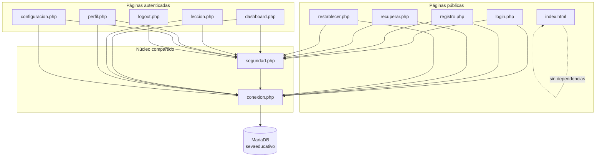

# 01 — Inventario de artefactos, LOC, endpoints y dependencias

**Proyecto:** SEVA — Sistema Educativo de Lengua de Señas
**Fase:** 7 (Auditoría de ingeniería inversa, D20)
**Fecha:** 2026-10-21
**Rama:** `fix/auditoria-defectos` · **Commit auditado:** `35747b6`
**Método:** análisis estático del árbol de trabajo + `git ls-files` + conteo de líneas + inspección de código

---

## 1. Resumen cuantitativo

| Métrica | Valor |
|---|---|
| Archivos versionados | **37** |
| Archivos PHP | **11** (9 páginas + 2 de soporte) |
| Líneas de PHP | **3.690** |
| Líneas de CSS | **1.335** (`css/estilos.css`) |
| Líneas de la landing | **1.232** (`index.html`) |
| Líneas de SQL versionado | **263** (`schema.sql` 142 + `seed_demo.sql` 121) |
| Líneas de `.htaccess` | **90** |
| Peso del código PHP | **154,7 KB** |
| Tablas en MariaDB | **8** |
| Imágenes de lección | **5** (4 JPG + 1 SVG de respaldo) |
| Videos | **0** (la carpeta existe y está documentada) |

> Conteo directo: `Get-ChildItem *.php | ForEach-Object { (Get-Content $_).Count }`.
> Los LOC incluyen líneas en blanco y comentarios (métrica bruta, no SLOC).
>
> El inventario refleja el commit `35747b6` (37 archivos). Los 7 documentos nuevos de esta fase se suman en el commit de cierre (44 archivos versionados).

---

## 2. Inventario de archivos versionados

### 2.1 Código y configuración

| Archivo | LOC | Rol |
|---|---:|---|
| `conexion.php` | 23 | Conexión PDO única; credenciales por variables de entorno |
| `seguridad.php` | 440 | Sesión, CSRF, honeypot, contraseñas, rate limit, entorno/URL |
| `login.php` | 484 | Autenticación + rate limit + rehash + regeneración de sesión |
| `registro.php` | 572 | Alta de usuario con validación servidor y honeypot |
| `dashboard.php` | 290 | Ruta de aprendizaje, progreso y filtros accesibles |
| `leccion.php` | 541 | Detalle de lección, vocabulario desde BD y progreso |
| `perfil.php` | 327 | Datos personales y estadísticas del estudiante |
| `configuracion.php` | 391 | Cambio de contraseña y preferencias de accesibilidad |
| `recuperar.php` | 314 | Solicitud de enlace de recuperación (D13) |
| `restablecer.php` | 298 | Consumo del token y cambio de contraseña (D13) |
| `logout.php` | 10 | Cierre de sesión por POST/GET dedicado (D08) |
| `css/estilos.css` | 1.335 | Design tokens y estilos compartidos |
| `index.html` | 1.232 | Landing pública estática |
| `.htaccess` | 90 | Cabeceras, CSP, HTTPS/HSTS condicional y bloqueo de archivos |
| `.gitattributes` / `.gitignore` | — | Fin de línea LF y exclusión de secretos/binarios |

### 2.2 Base de datos

| Archivo | LOC | Rol |
|---|---:|---|
| `DataBase/schema.sql` | 142 | Esquema completo (8 tablas) |
| `DataBase/seed_demo.sql` | 121 | Datos ficticios: 12 lecciones, 50 señas, 2 usuarios demo |
| `DataBase/migrations/001_intentos_login.sql` | 15 | Tabla anti fuerza bruta |
| `DataBase/migrations/002_recuperacion_password.sql` | 34 | Tokens de recuperación |
| `DataBase/migrations/003_vocabulario_senas.sql` | 29 | Vocabulario por lección |
| `DataBase/README.md` | 71 | Instalación, migraciones y credenciales demo |

### 2.3 Recursos y documentación

| Archivo | Rol |
|---|---|
| `img/interfaz/logo_seva.jpg` | Logotipo |
| `img/lecciones/{alfabeto,colores,numeros,saludos}.jpg` | Portadas existentes |
| `img/lecciones/default.svg` | Placeholder vectorial (D14) |
| `video/.gitkeep`, `video/README.md` | Carpeta de clips y requisitos (D15) |
| `docs/MEMORIA_PROYECTO.md` | Fuente de verdad funcional (parcialmente corrupta, D19) |
| `docs/PLAN_REMEDIACION.md` | Plan de remediación y criterios de aceptación |
| `docs/AUDITORIA/*` | Esta auditoría |
| `docs/repomix-output.xml` | Volcado histórico del código (artefacto de documentación) |
| `docs/sevaeducativo.json` | Metadatos del proyecto |
| `docs/.antigravityrules.md`, `docs/README.md` | Reglas de trabajo y descripción |

---

## 3. Grafo de dependencias (`require`/`include`)

Todas las dependencias son explícitas; no hay autoloader, namespaces ni framework.



| Archivo | `require` |
|---|---|
| `login.php`, `registro.php`, `recuperar.php`, `restablecer.php`, `dashboard.php`, `leccion.php`, `perfil.php`, `configuracion.php` | `conexion.php` + `seguridad.php` |
| `logout.php` | `seguridad.php` |
| `conexion.php`, `seguridad.php`, `index.html` | — |

**Observaciones**

- `seguridad.php` no abre conexión: recibe `$pdo` por parámetro en las funciones que lo necesitan (bajo acoplamiento).
- `logout.php` no requiere `conexion.php` porque no consulta la base de datos.
- No quedan referencias a `db.php` (eliminado en Fase 1, D03).
- `index.html` es estático y no comparte sesión con la aplicación PHP.

---

## 4. Mapa de endpoints

| Endpoint | Métodos | Autenticación | CSRF | Acción / parámetros |
|---|---|---|---|---|
| `index.html` | GET | Pública | — | Landing informativa |
| `login.php` | GET, POST | Pública (redirige si ya hay sesión) | POST | `email`, `password`, `seva_web` (honeypot) |
| `registro.php` | GET, POST | Pública | POST | `nombre`, `email`, `password`, `confirmar`, `seva_web` |
| `recuperar.php` | GET, POST | Pública | POST | `email`, `seva_web` |
| `restablecer.php` | GET, POST | Pública con token | POST | `token`, `password`, `password_confirm` |
| `dashboard.php` | GET | Sesión requerida | — | — |
| `leccion.php` | GET, POST | Sesión requerida | POST | `id` (GET, casteado a entero); `marcar_completada` |
| `perfil.php` | GET, POST | Sesión requerida | POST | `accion=actualizar_nombre`, `nombre` |
| `configuracion.php` | GET, POST | Sesión requerida | POST | `accion=cambiar_password`, `pass_actual`, `pass_nueva`, `pass_confirmar` |
| `logout.php` | GET, POST | Sesión | — | Destruye la sesión y redirige |

**Comportamiento sin sesión (verificado):** `dashboard.php`, `perfil.php`, `configuracion.php` y `leccion.php` responden **302 → `login.php`**.

**Formularios POST y CSRF:** los 7 formularios que mutan estado incluyen `csrf_campo()` y llaman a `seguridad_validar_csrf()` antes de procesar (`login`, `registro`, `recuperar`, `restablecer`, `leccion`, `perfil`, `configuracion`). Un POST sin token se rechaza con `?error=csrf` (ver `06-pruebas.md`).

---

## 5. Convenciones y deuda técnica observable

| Aspecto | Estado |
|---|---|
| Estilo | PHP procedural, sin framework ni Composer |
| Entrada de datos | `$_GET`/`$_POST` con `trim`, casteo y validación por página |
| Salida HTML | `htmlspecialchars()` (59 usos) con `ENT_QUOTES`/UTF-8 |
| SQL | PDO con consultas preparadas (27 `prepare`) y `EMULATE_PREPARES=false` |
| Configuración | Credenciales por `DB_*`; `APP_ENV` por entorno |
| Pruebas automatizadas | No hay suite ni PHPUnit (solo pruebas manuales documentadas) |
| Código muerto | `cursos` y `palabras_repasadas` existen en BD pero no tienen interfaz |
| Documentación | `docs/repomix-output.xml` duplica el código y puede quedar desfasado |

---

## 6. Reproducción

```powershell
cd C:\xampp\htdocs\seva
git ls-files
Get-ChildItem *.php | ForEach-Object { "{0}: {1}" -f $_.Name, (Get-Content $_.FullName).Count }
Select-String -Path *.php -Pattern '^\s*(require|include)'
Select-String -Path *.php -Pattern 'REQUEST_METHOD'
```
