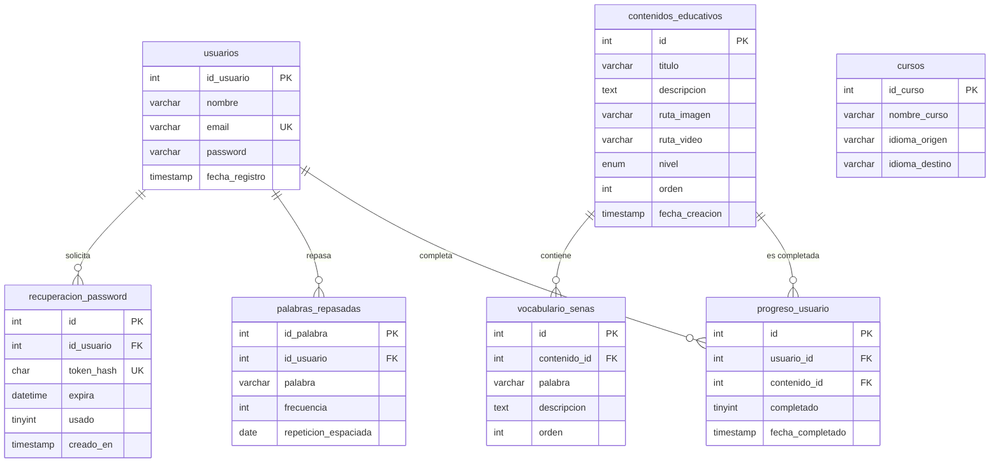

# 02 — Modelo de datos reconstruido

**Proyecto:** SEVA — Sistema Educativo de Lengua de Señas
**Fase:** 7 (D20) · **Fecha:** 2026-10-21
**Motor:** MariaDB 10.4.32 · **Base:** `seva_educativo`
**Método:** reconstrucción desde `information_schema` y `SHOW CREATE TABLE`, contrastada con `DataBase/schema.sql`

---

## 1. Diagrama entidad-relación (Mermaid)



> `cursos` no tiene relaciones: es una tabla de catálogo sin uso en el código actual.

---

## 2. Detalle de tablas

Todas las tablas son **InnoDB** con `utf8mb4_general_ci` (comparación de correos y palabras **sin distinción de mayúsculas**).

### 2.1 `usuarios`

| Columna | Tipo | Restricción |
|---|---|---|
| `id_usuario` | `int(11)` | PK, AUTO_INCREMENT |
| `nombre` | `varchar(100)` | NOT NULL |
| `email` | `varchar(150)` | NOT NULL, UNIQUE |
| `password` | `varchar(255)` | NOT NULL, hash bcrypt (60 caracteres) |
| `fecha_registro` | `timestamp` | DEFAULT CURRENT_TIMESTAMP |

### 2.2 `contenidos_educativos`

| Columna | Tipo | Restricción |
|---|---|---|
| `id` | `int(11)` | PK, AUTO_INCREMENT |
| `titulo` | `varchar(150)` | NOT NULL |
| `descripcion` | `text` | NULL |
| `ruta_imagen` | `varchar(255)` | NULL (validada en disco al renderizar) |
| `ruta_video` | `varchar(255)` | NULL (validada en disco al renderizar) |
| `nivel` | `enum('basico','intermedio','avanzado')` | NOT NULL, DEFAULT `basico` |
| `orden` | `int(11)` | NOT NULL, DEFAULT 0 (sin UNIQUE) |
| `fecha_creacion` | `timestamp` | DEFAULT CURRENT_TIMESTAMP |

### 2.3 `progreso_usuario`

| Columna | Tipo | Restricción |
|---|---|---|
| `id` | `int(11)` | PK, AUTO_INCREMENT |
| `usuario_id` | `int(11)` | FK → `usuarios.id_usuario` |
| `contenido_id` | `int(11)` | FK → `contenidos_educativos.id` |
| `completado` | `tinyint(1)` | NOT NULL, DEFAULT 0 |
| `fecha_completado` | `timestamp` | NULL |

- `UNIQUE (usuario_id, contenido_id)` → una fila por usuario y lección (permite `ON DUPLICATE KEY UPDATE`).
- FKs con `ON DELETE CASCADE ON UPDATE CASCADE`.

### 2.4 `palabras_repasadas`

| Columna | Tipo | Restricción |
|---|---|---|
| `id_palabra` | `int(11)` | PK, AUTO_INCREMENT |
| `id_usuario` | `int(11)` | FK → `usuarios.id_usuario` (CASCADE) |
| `palabra` | `varchar(100)` | NOT NULL |
| `frecuencia` | `int(11)` | DEFAULT 0 |
| `repeticion_espaciada` | `date` | NULL |

> Sin uso en la interfaz actual (repetición espaciada pendiente).

### 2.5 `cursos`

| Columna | Tipo | Restricción |
|---|---|---|
| `id_curso` | `int(11)` | PK, AUTO_INCREMENT |
| `nombre_curso` | `varchar(100)` | NOT NULL |
| `idioma_origen` | `varchar(50)` | NULL |
| `idioma_destino` | `varchar(50)` | NULL |

> Catálogo sin uso en el código actual.

### 2.6 `intentos_login`

| Columna | Tipo | Restricción |
|---|---|---|
| `id` | `int(11)` | PK, AUTO_INCREMENT |
| `ip` | `varchar(45)` | NOT NULL |
| `email` | `varchar(150)` | NOT NULL |
| `intentos` | `int(11)` | NOT NULL, DEFAULT 0 |
| `bloqueado_hasta` | `datetime` | NULL |
| `actualizado` | `timestamp` | ON UPDATE CURRENT_TIMESTAMP |

- `UNIQUE (ip, email)` → contador por combinación.
- **Sin FK a `usuarios`**: debe registrar intentos con correos inexistentes (decisión de diseño).
- Reutilizada por el flujo de recuperación con la clave `recuperacion:<email>` para no bloquear el login.

### 2.7 `recuperacion_password`

| Columna | Tipo | Restricción |
|---|---|---|
| `id` | `int(11)` | PK, AUTO_INCREMENT |
| `id_usuario` | `int(11)` | FK → `usuarios.id_usuario` (CASCADE) |
| `token_hash` | `char(64)` | NOT NULL, UNIQUE (SHA-256 hexadecimal) |
| `expira` | `datetime` | NOT NULL (NOW() + 30 min) |
| `usado` | `tinyint(1)` | NOT NULL, DEFAULT 0 |
| `creado_en` | `timestamp` | DEFAULT CURRENT_TIMESTAMP |

> Nunca se almacena el token en claro; el enlace solo se muestra con `APP_ENV=local` y se registra en `error_log`.

### 2.8 `vocabulario_senas`

| Columna | Tipo | Restricción |
|---|---|---|
| `id` | `int(11)` | PK, AUTO_INCREMENT |
| `contenido_id` | `int(11)` | FK → `contenidos_educativos.id` (CASCADE) |
| `palabra` | `varchar(100)` | NOT NULL |
| `descripcion` | `text` | NOT NULL |
| `orden` | `int(11)` | NOT NULL, DEFAULT 0 |

- `UNIQUE (contenido_id, palabra)` → evita duplicados dentro de una lección.
- `INDEX (contenido_id, orden)` → consulta ordenada del vocabulario.

---

## 3. Claves foráneas (5)

| Tabla | Constraint | Columna | Referencia | Borrado |
|---|---|---|---|---|
| `progreso_usuario` | `fk_progreso_usuario_usuario` | `usuario_id` | `usuarios.id_usuario` | CASCADE |
| `progreso_usuario` | `fk_progreso_usuario_contenido` | `contenido_id` | `contenidos_educativos.id` | CASCADE |
| `palabras_repasadas` | `fk_palabras_usuario` | `id_usuario` | `usuarios.id_usuario` | CASCADE |
| `recuperacion_password` | `fk_recuperacion_usuario` | `id_usuario` | `usuarios.id_usuario` | CASCADE |
| `vocabulario_senas` | `fk_vocabulario_contenido` | `contenido_id` | `contenidos_educativos.id` | CASCADE |

**Verificación de huérfanos:** 0 en las cinco relaciones.

```sql
SELECT COUNT(*) FROM progreso_usuario p
LEFT JOIN usuarios u ON u.id_usuario = p.usuario_id
WHERE u.id_usuario IS NULL;  -- 0
```

---

## 4. Índices (20)

| Tabla | Índice | Columnas | Tipo |
|---|---|---|---|
| `usuarios` | PRIMARY | `id_usuario` | Único |
| `usuarios` | `email` | `email` | Único |
| `contenidos_educativos` | PRIMARY | `id` | Único |
| `progreso_usuario` | PRIMARY | `id` | Único |
| `progreso_usuario` | `uk_usuario_contenido` | `usuario_id, contenido_id` | Único |
| `progreso_usuario` | `fk_progreso_usuario_usuario` | `usuario_id` | Normal |
| `progreso_usuario` | `fk_progreso_usuario_contenido` | `contenido_id` | Normal |
| `palabras_repasadas` | PRIMARY | `id_palabra` | Único |
| `palabras_repasadas` | `fk_palabras_usuario` | `id_usuario` | Normal |
| `cursos` | PRIMARY | `id_curso` | Único |
| `intentos_login` | PRIMARY | `id` | Único |
| `intentos_login` | `uk_ip_email` | `ip, email` | Único |
| `intentos_login` | `idx_actualizado` | `actualizado` | Normal |
| `recuperacion_password` | PRIMARY | `id` | Único |
| `recuperacion_password` | `uk_token_hash` | `token_hash` | Único |
| `recuperacion_password` | `idx_id_usuario` | `id_usuario` | Normal |
| `recuperacion_password` | `idx_expira` | `expira` | Normal |
| `vocabulario_senas` | PRIMARY | `id` | Único |
| `vocabulario_senas` | `uk_contenido_palabra` | `contenido_id, palabra` | Único |
| `vocabulario_senas` | `idx_contenido_orden` | `contenido_id, orden` | Normal |

---

## 5. Volumen actual

| Tabla | Filas |
|---|---:|
| `usuarios` | 5 |
| `contenidos_educativos` | 12 |
| `vocabulario_senas` | 50 |
| `progreso_usuario` | 4 |
| `palabras_repasadas` | 0 |
| `cursos` | 0 |
| `intentos_login` | 0 |
| `recuperacion_password` | 0 |

> Los datos de prueba de esta auditoría fueron eliminados; los contadores de intentos y tokens también se purgaron.

---

## 6. Observaciones del modelo

| Observación | Impacto | Estado |
|---|---|---|
| Nomenclatura mixta `id_usuario` vs `usuario_id` | Bajo (claridad) | Deuda documentada |
| `contenidos_educativos.orden` sin UNIQUE | Bajo (orden duplicado posible) | Aceptado |
| `cursos` y `palabras_repasadas` sin uso | Bajo (tablas muertas) | Documentado |
| `intentos_login` sin FK | Intencional (correos inexistentes) | Correcto |
| La BD viva conserva IDs legacy `1234567899…` | Operativo | No se renumeró para no tocar cuentas reales |
| El seed versionado usa IDs `1..n` | Correcto en instalaciones nuevas | Verificado en Fase 6 |
| Correos comparados sin distinguir mayúsculas | Bajo | `utf8mb4_general_ci` |

---

## 7. Reproducción

```sql
SHOW CREATE TABLE usuarios;
SELECT TABLE_NAME, ENGINE, TABLE_COLLATION, TABLE_ROWS
FROM information_schema.TABLES WHERE TABLE_SCHEMA = 'seva_educativo';
SELECT TABLE_NAME, CONSTRAINT_NAME, COLUMN_NAME, REFERENCED_TABLE_NAME
FROM information_schema.KEY_COLUMN_USAGE
WHERE TABLE_SCHEMA = 'seva_educativo' AND REFERENCED_TABLE_NAME IS NOT NULL;
SELECT TABLE_NAME, INDEX_NAME, COLUMN_NAME
FROM information_schema.STATISTICS WHERE TABLE_SCHEMA = 'seva_educativo';
```
