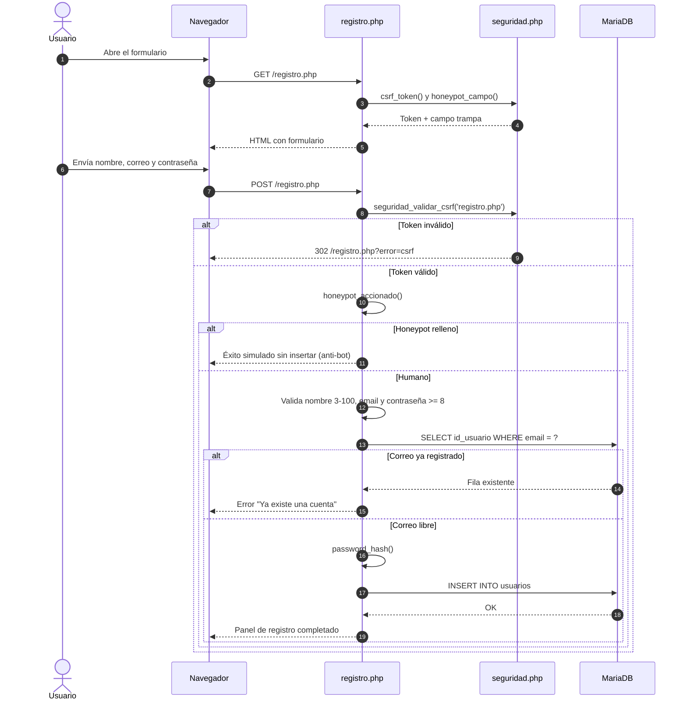
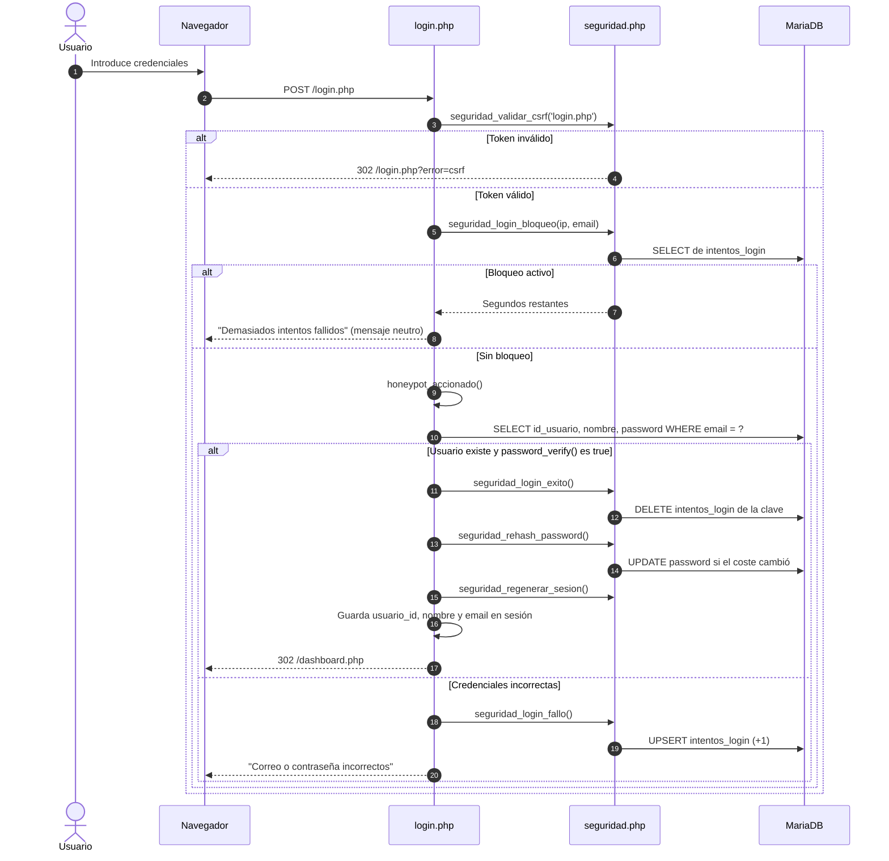
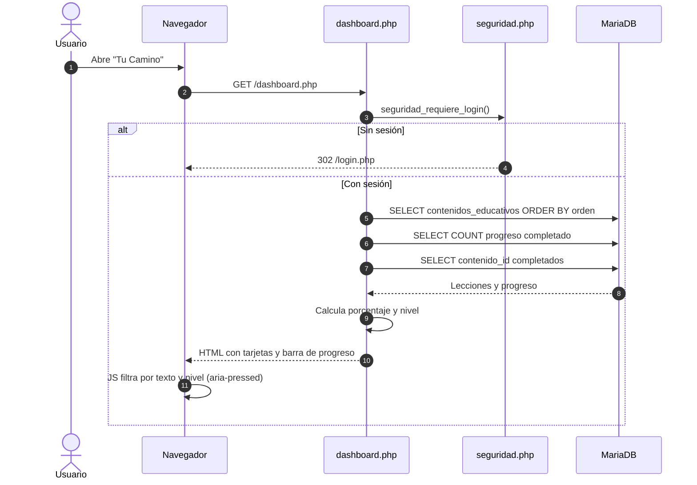
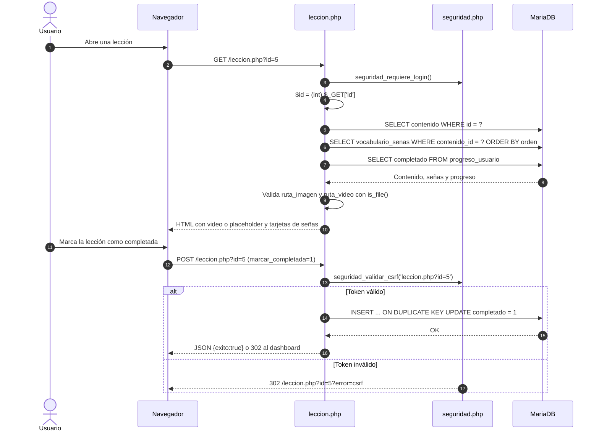
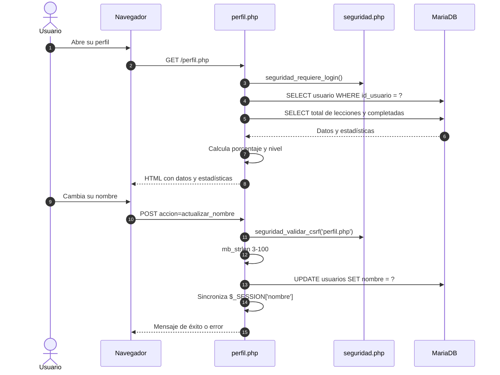
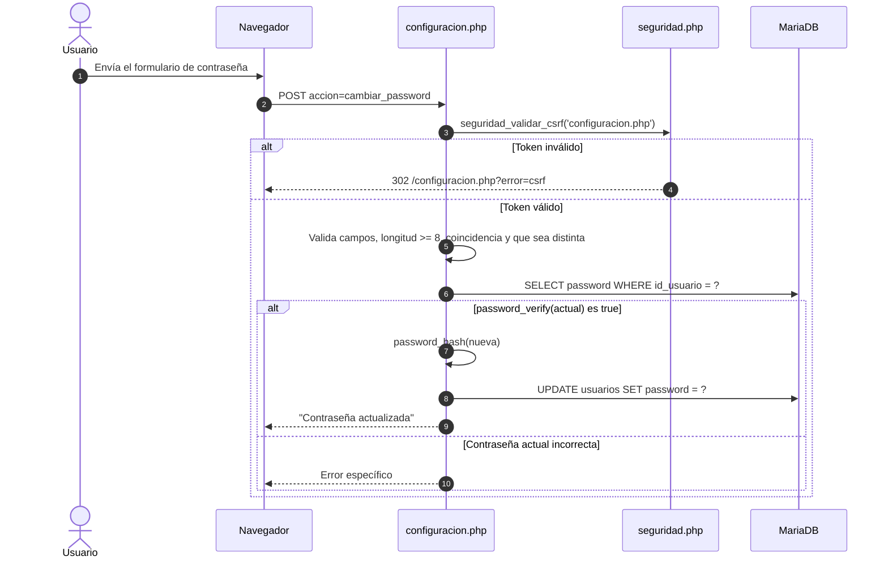
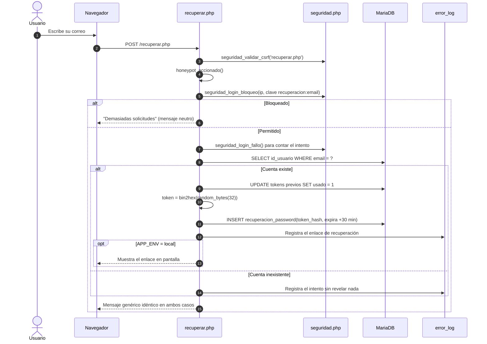
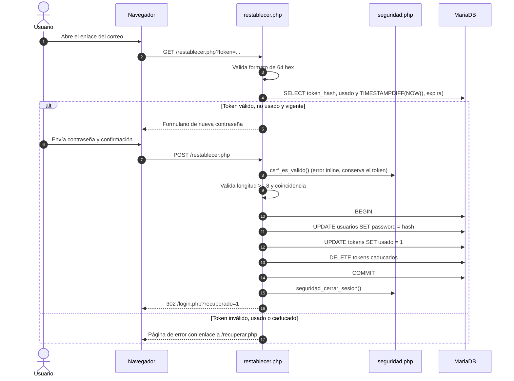
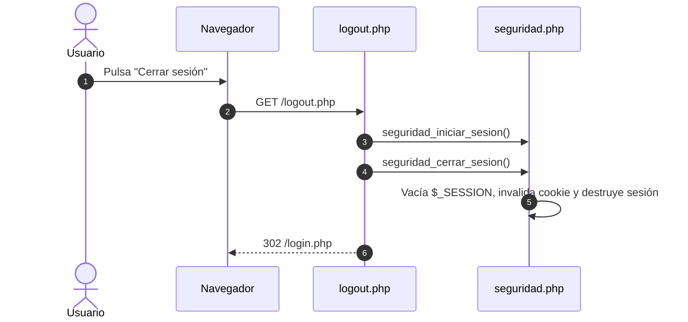

# 03 — Flujos de datos y diagramas de secuencia

**Proyecto:** SEVA — Sistema Educativo de Lengua de Señas
**Fase:** 7 (D20) · **Fecha:** 2026-10-21
**Método:** lectura del código (`login.php`, `registro.php`, `dashboard.php`, `leccion.php`, `perfil.php`, `configuracion.php`, `recuperar.php`, `restablecer.php`, `seguridad.php`) y verificación HTTP
**Diagramas:** 9 (7 flujos principales, recuperación en 2 fases y cierre de sesión)

---

## 0. Reglas transversales

| Control | Implementación |
|---|---|
| Sesión | `seguridad_iniciar_sesion()`: `use_strict_mode`, `HttpOnly`, `SameSite=Lax`, `Secure` en HTTPS |
| Autenticación | `seguridad_requiere_login()` redirige a `login.php` si no hay `usuario_id` |
| CSRF | Token de 32 bytes en sesión; `seguridad_validar_csrf($destino)` redirige con `?error=csrf` |
| Escapado | `htmlspecialchars($v, ENT_QUOTES, 'UTF-8')` en todas las salidas de usuario |
| SQL | PDO + `prepare()`; `ATTR_EMULATE_PREPARES = false` |
| Contraseñas | `password_hash(PASSWORD_DEFAULT)` / `password_verify` + rehash |
| Anti-bot | Campo trampa `seva_web` (oculto) |
| Rate limit | 5 fallos por IP + correo → 15 minutos (`intentos_login`) |

---

## 1. Registro de usuario (`registro.php`)

**Notas**

- La validación del nombre es doble: `minlength/maxlength` en HTML y `mb_strlen` 3–100 en servidor (D22).
- El honeypot simula éxito para no dar pistas al bot.
- No hay envío de correo de verificación (fuera de alcance).

---

## 2. Inicio de sesión (`login.php`)

**Notas**

- El bloqueo se evalúa antes de consultar al usuario: no revela si la cuenta existe.
- `session_regenerate_id(true)` invalida el ID previo (fijación de sesión, D06).
- El rehash mantiene compatibilidad con hashes antiguos (D07).

---

## 3. Dashboard y progreso (`dashboard.php`)

**Notas**

- El filtrado es 100 % cliente: no genera peticiones ni recarga.
- Las tarjetas usan `is_file()` para caer en `img/lecciones/default.svg` (D14).
- El contador de resultados tiene `role="status"` y `aria-live="polite"` (D17).

---

## 4. Lección y marcado de progreso (`leccion.php`)

**Notas**

- Si el clip no existe, se muestra un placeholder accesible en lugar de un reproductor roto (D15).
- Si la lección no tiene vocabulario, se muestra un estado vacío (Fase 6).
- El progreso de las casillas de práctica se guarda en `localStorage` por lección; el progreso de la lección, en la base de datos.

---

## 5. Perfil del estudiante (`perfil.php`)

---

## 6. Configuración y cambio de contraseña (`configuracion.php`)

**Notas**

- Las preferencias de accesibilidad (tamaño de fuente y movimiento reducido) se guardan en `localStorage` y se aplican antes de pintar el DOM; no se persisten en la base de datos.
- El cambio de contraseña no invalida otras sesiones abiertas (no hay tabla de sesiones).

---

## 7. Recuperación de contraseña

### 7.1 Solicitud del enlace (`recuperar.php`)

### 7.2 Restablecimiento (`restablecer.php`)

**Notas**

- La vigencia se compara en SQL (`TIMESTAMPDIFF`) para evitar desfases de zona horaria.
- Un token nuevo invalida los anteriores del mismo usuario.
- El CSRF inválido no redirige: muestra el error y conserva el token para reintentar.
- En producción no se envía correo real: el enlace queda en `error_log` (decisión de alcance).

---

## 8. Cierre de sesión (`logout.php`)

