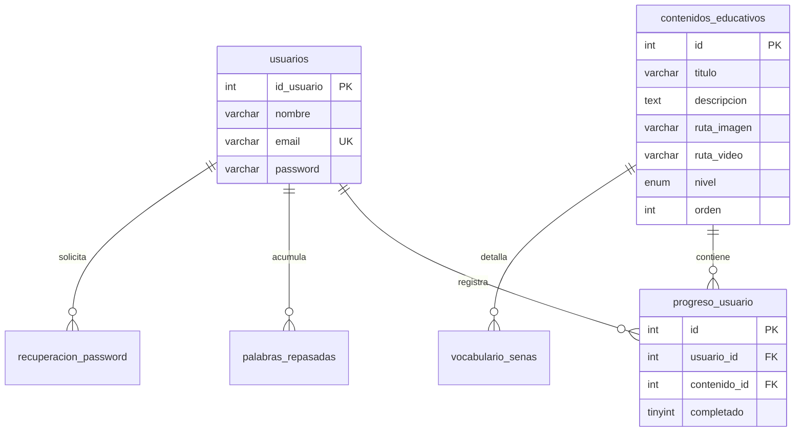

# Guía Maestra para la Creación del README.md del Proyecto SEVA

Esta guía establece los lineamientos técnicos, pedagógicos, de accesibilidad e ingeniería de software para transformar el archivo `README.md` del repositorio **SEVA (Sistema Educativo de Lengua de Señas)** en una documentación de nivel profesional, visualmente atractiva y rigurosamente estructurada.

---

## 1. Visión General y Estructura del README.md

El archivo `README.md` de un proyecto educativo de alto impacto como SEVA debe cumplir múltiples funciones: presentar el propósito social del sistema, detallar su arquitectura técnica y de seguridad, documentar los criterios de accesibilidad e inclusión, y guiar paso a paso la instalación tanto en entornos locales como en producción.

### 1.1 Elementos Visuales e Identidad Gráfica Recomendados
* **Badges Oficiales**: Indicadores de versión de PHP (8.2+), motor MariaDB (`sevaeducativo`), cumplimiento de accesibilidad WCAG 2.1 AA y estado de seguridad OWASP.
* **Jerarquía y Separadores**: Uso de líneas divisoras semánticas y bloques explicativos en Markdown.
* **Demostraciones de Módulos**: Marcadores reservados para capturas del detector de señas con IA (MediaPipe), el camino de aprendizaje gamificado y el panel de ajustes de accesibilidad.

### 1.2 Arquitectura Modular Sugerida para el README
El documento final para el repositorio debe estructurarse en 7 secciones principales:

1. **Encabezado e Identidad**: Nombre del proyecto, eslogan e indicadores de estado.
2. **Propósito e Inclusión Social**: Fundamentos pedagógicos, Diseño Universal para el Aprendizaje (DUA) y contexto de la Lengua de Señas Colombiana (LSC).
3. **Arquitectura de Software y Seguridad**: Separación de directorios (`public/` vs `config/`), base de datos `sevaeducativo` y mitigaciones de seguridad OWASP.
4. **UX/UI y Accesibilidad (WCAG 2.1 AA & Leyes de UX)**: Aplicación de las leyes ergonómicas de UX y pautas computacionales W3C.
5. **Módulos Interactivos y Gamificación**: Detector con cámara e IA (`camara/detector.php`), puntos XP, racha de práctica y repetición espaciada.
6. **Instalación y Despliegue**: Manual de configuración en XAMPP y producción en Hostinger.
7. **Documentación y Licencia**: Créditos institucionales y referencias a la auditoría técnica.

---

## 2. Especificación Completa del Contenido Propuesto para el README.md

A continuación se detalla la propuesta completa del texto y estructura técnica que debe contener el archivo `README.md` del repositorio:

```markdown
# 🤟 SEVA — Sistema Educativo de Lengua de Señas

**Plataforma Web Educativa, Inclusiva y Gamificada para el Aprendizaje de Lengua de Señas Colombiana (LSC)**

---

## 📌 Tabla de Contenidos
- [Acerca del Proyecto](#acerca-del-proyecto)
- [Principios Pedagógicos e Inclusión](#principios-pedagógicos-e-inclusión)
- [Arquitectura de Software](#arquitectura-de-software)
- [Seguridad y Endurecimiento](#seguridad-y-endurecimiento)
- [Diseño UX/UI y Leyes Cognitivas](#diseño-uxui-y-leyes-cognitivas)
- [Accesibilidad W3C / WCAG 2.1 AA](#accesibilidad-w3c--wcag-21-aa)
- [Módulos Interactivos y Gamificación](#módulos-interactivos-y-gamificación)
- [Modelo de Datos (`sevaeducativo`)](#modelo-de-datos-sevaeducativo)
- [Guía de Instalación y Despliegue](#guía-de-instalación-y-despliegue)
- [Créditos y Licencia](#créditos-y-licencia)

---

## 🎯 Acerca del Proyecto

SEVA (Sistema Educativo de Lengua de Señas) es una plataforma tecnológica web concebida para derribar las barreras de comunicación que afectan a las personas con discapacidad auditiva, facilitando el aprendizaje interactivo de la Lengua de Señas Colombiana (LSC).

El sistema integra lecciones interactivas, seguimiento de gestos en tiempo real mediante visión artificial (MediaPipe Hand Tracking), algoritmos de repetición espaciada y una interfaz gamificada construida bajo los estándares internacionales de accesibilidad web.

---

## 📚 Principios Pedagógicos e Inclusión

El diseño instruccional de SEVA se fundamenta en tres pilares pedagógicos:

* **Diseño Universal para el Aprendizaje (DUA)**: Presentación del contenido mediante canales multisensoriales (video demostrativo en LSC, ilustraciones de dactilología, descripciones textuales y apoyo visual).
* **Sistema Hipermedia Adaptativo (SHA)**: Evaluación del avance del usuario para personalizar la ruta de lecciones y sugerencias de repaso.
* **Repetición Espaciada**: Retención del vocabulario mediante el monitoreo de la frecuencia de práctica almacenada en la base de datos (`palabras_repasadas`).

---

## 🏗️ Arquitectura de Software

El sistema aplica el principio de **Defensa en Profundidad**, aislando los archivos de configuración y base de datos fuera de la raíz pública accesible por el navegador (*DocumentRoot*).

```text
seva/
├── config/                  ← (PROTEGIDO: conexion.php, seguridad.php - Fuera de la web pública)
├── DataBase/                ← (PROTEGIDO: schema.sql, seed_demo.sql, migrations/)
├── docs/                    ← (PROTEGIDO: AUDITORIA/, MEMORIA_PROYECTO.md)
└── public/                  ← (DOCUMENT ROOT: Única carpeta servida vía HTTP)
    ├── index.html           ← Landing page institucional accesible
    ├── login.php            ← Autenticación endurecida
    ├── registro.php         ← Alta de usuario con validación en servidor
    ├── dashboard.php        ← Ruta de aprendizaje "Tu Camino"
    ├── leccion.php          ← Visor interactivo de lección con modo guiado
    ├── practica.php         ← Centro de minijuegos interactivos
    ├── perfil.php           ← Estadísticas del estudiante
    ├── configuracion.php    ← Ajustes de accesibilidad y contraseña
    ├── logout.php           ← Cierre de sesión seguro
    ├── css/                 ← Design Tokens (estilos.css, juegos.css)
    ├── js/                  ← Lógica del cliente (seva-ui.js)
    ├── img/                 ← Ilustraciones SVG, portadas y señas LSC
    ├── media/               ← Demostraciones en video MP4
    ├── data/                ← Datasets en formato JSON
    ├── partials/            ← Barra de navegación compartida (topbar.php)
    └── camara/              ← Módulo con IA para el detector de señas (detector.php)
```

---

## 🔒 Seguridad y Endurecimiento

SEVA incorpora múltiples capas de protección derivadas de una auditoría estricta sobre las vulnerabilidades OWASP Top 10:

| Mecanismo | Implementación Técnica |
| :--- | :--- |
| **Aislamiento Web** | Exclusividad de `public/` como *DocumentRoot*. Las credenciales y scripts SQL residen en directorios superiores protegidos. |
| **Protección CSRF** | Tokens criptográficos de 32 bytes validados en todas las peticiones mutativas por POST. |
| **Rate Limiting** | Bloqueo temporal de 15 minutos tras acumular 5 intentos fallidos en la tabla `intentos_login`. |
| **Protección Anti-Bots** | Campo trampa (*Honeypot* `seva_web`) en formularios de autenticación con desvío silencioso. |
| **Contraseñas Seguras** | Algoritmo `bcrypt` mediante `password_hash()`, `password_verify()` y rehash automático. |
| **Sesiones Endurecidas** | Cookies con flags `HttpOnly`, `SameSite=Lax`, `Secure` en HTTPS y regeneración de ID tras login. |
| **Compatibilidad BD** | Base de datos renombrada a `sevaeducativo` para garantizar compatibilidad con Hostinger. |

---

## 🎨 Diseño UX/UI y Leyes Cognitivas

La interfaz de usuario implementa leyes clave de la experiencia de usuario y la ergonomía digital:

* **Ley de Fitts**: Todos los botones e insumos táctiles poseen una dimensión mínima de **44×44 px**.
* **Ley de Miller y Hick**: Contenido categorizado por niveles de dificultad (*Básico, Intermedio, Avanzado*), minimizando la sobrecarga cognitiva.
* **Efecto Zeigarnik**: Anillo y barra de progreso porcentual visible en el Dashboard para motivar a completar tareas pendientes.
* **Ley de Pregnanz y Proximidad**: Distribución mediante rejillas adaptativas (*CSS Grid*) con agrupación clara por color y contraste.
* **Ley de Tesler**: Simplificación del número de campos obligatorios en los formularios.
* **Ley de Jakob**: Respeto a los patrones de navegación estándar en la Web.

---

## ♿ Accesibilidad W3C / WCAG 2.1 AA

SEVA cumple con las directrices internacionales de accesibilidad web:

* **Navegación por Teclado**: Borde visual resaltado (`:focus-visible` de 3px) para navegación mediante la tecla Tab.
* **Movimiento Reducido**: Compatibilidad con `@media (prefers-reduced-motion: reduce)` y conmutador manual de animaciones.
* **Feedback Multimodal**: Combinación de iconos, avisos de texto e indicadores de estado anunciado mediante WAI-ARIA (`role="status"`, `aria-live="polite"`).
* **Multimedia Adaptada**: Transcripciones gestuales detalladas y contenedores con relación de aspecto 16:9.

---

## 🎮 Módulos Interactivos y Gamificación

* **Detector de Señas con IA (`camara/detector.php`)**: Evaluación en tiempo real de la posición de la mano mediante visión artificial con MediaPipe.
* **Gamificación Integrada**: Puntos de experiencia (XP), racha de días de práctica y animación de celebración con confeti en canvas.
* **Modo Guiado en Lecciones**: Navegación paso a paso por cada seña con tarjetas detalladas e instrucciones de movimiento.

---

## 🗄️ Modelo de Datos (`sevaeducativo`)

La base de datos relacional consta de **8 tablas** InnoDB codificadas en `utf8mb4_general_ci`:
`usuarios`, `contenidos_educativos`, `progreso_usuario`, `vocabulario_senas`, `palabras_repasadas`, `cursos`, `intentos_login`, `recuperacion_password`.



---

## 🚀 Guía de Instalación y Despliegue

### 1. Instalación Local (XAMPP)

1. Clonar el proyecto en el directorio del servidor Apache:
   ```bash
   cd C:\xampp\htdocs
   git clone https://github.com/Cathartes137-projects/seva.git
   ```

2. Crear la base de datos en MariaDB:
   ```sql
   CREATE DATABASE sevaeducativo CHARACTER SET utf8mb4 COLLATE utf8mb4_general_ci;
   ```

3. Importar el esquema y los datos iniciales:
   ```bash
   mysql -u root sevaeducativo < DataBase/schema.sql
   mysql -u root sevaeducativo < DataBase/seed_demo.sql
   ```

4. Configurar `config/conexion.php` y acceder desde el navegador a `http://localhost/seva/public/`.

---

### 2. Despliegue en Producción (Hostinger)

1. Subir la estructura al servidor web de Hostinger y hacer que el dominio apunte a la carpeta `public/` como *DocumentRoot*.
2. Crear la base de datos MariaDB `sevaeducativo` desde phpMyAdmin en Hostinger e importar `schema.sql` y `seed_demo.sql`.
3. Actualizar `config/conexion.php` con las credenciales de usuario y contraseña generadas en el hosting.
4. Verificar la activación del certificado SSL para que la redirección HTTPS y las cabeceras HSTS funcionen automáticamente.

---

## 📝 Créditos y Licencia

Desarrollado como proyecto de innovación tecnológica e inclusión educativa.

* **Repositorio**: [Cathartes137-projects / seva](https://github.com/Cathartes137-projects/seva)
* **Licencia**: MIT License.
```

---

## 3. Evaluación de Herramientas de Agentes para la Ejecución

Para llevar a cabo la creación del archivo `README.md` real en la carpeta del proyecto local (`C:\xampp\htdocs\seva\`), se analizaron las dos herramientas de agentes disponibles:

| Criterio de Evaluación | **Hermes (Agente de Inspección y Edición)** | **Kilo CLI (Agente CLI de Comandos)** |
| :--- | :--- | :--- |
| **Acceso al Entorno Local** | Opera directamente sobre `C:\xampp\htdocs\seva\` sin restricciones de entorno. | Trabaja dentro de un workspace aislado que a veces requiere sincronización manual. |
| **Escritura de Documentos** | Maneja la edición directa de archivos en disco sin fallar por bloques de código Markdown. | Presentó interrupciones previas en la herramienta `write` cuando procesó textos muy extensos. |
| **Memoria del Proyecto** | Conoce la arquitectura final de `public/`, `config/` y la base de datos `sevaeducativo`. | Requiere volver a pasarle el contexto antes de editar. |
| **Dictamen Final** | 🌟 **RECOMENDADO (Elección Principal)** | Opción Secundaria |

### 🏆 Recomendación
La tarea debe ser asignada a **Hermes**, indicándole explícitamente que redacte y guarde el archivo directamente en `C:\xampp\htdocs\seva\README.md`.

---

## 4. Prompt Final para Enviar a Hermes

Copia y pega el siguiente mensaje en tu sesión con **Hermes**:

```text
Hola Hermes. Vamos a crear el archivo README.md definitivo en la raiz del repositorio C:\xampp\htdocs\seva\README.md

OBJETIVO:
Reemplazar el README.md actual por una documentacion completa, profesional, bien estructurada y con los detalles tecnicos actualizados.

INSTRUCCIONES DE ESCRITURA:
1. Escribe el contenido directamente en el archivo C:\xampp\htdocs\seva\README.md
2. Incluye las siguientes secciones principales:
   - Header y titulo oficial de SEVA.
   - Tabla de contenidos interactiva.
   - Acerca del proyecto y Principios Pedagogicos (DUA, SHA, Repeticion Espaciada).
   - Estructura de carpetas detallando public/ (DocRoot) y config/ (Protegido).
   - Tabla de Seguridad y Endurecimiento OWASP (CSRF, Rate limit, Honeypot, Bcrypt, CSP, BD sevaeducativo).
   - Principios de UX/UI (Fitts 44px, Zeigarnik, Miller) y Accesibilidad WCAG (foco 3px, ARIA).
   - Modulo de Detector de Senas con IA (MediaPipe) y gamificacion.
   - Diagrama ERD en Mermaid de la base de datos sevaeducativo.
   - Guia de instalacion en XAMPP y despliegue en Hostinger.
   - Creditos y Licencia MIT.

Por favor genera el archivo C:\xampp\htdocs\seva\README.md y confirmame cuando quede guardado en disco.
```
